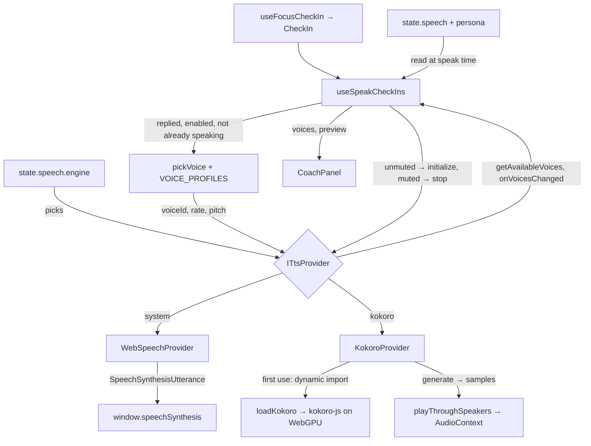
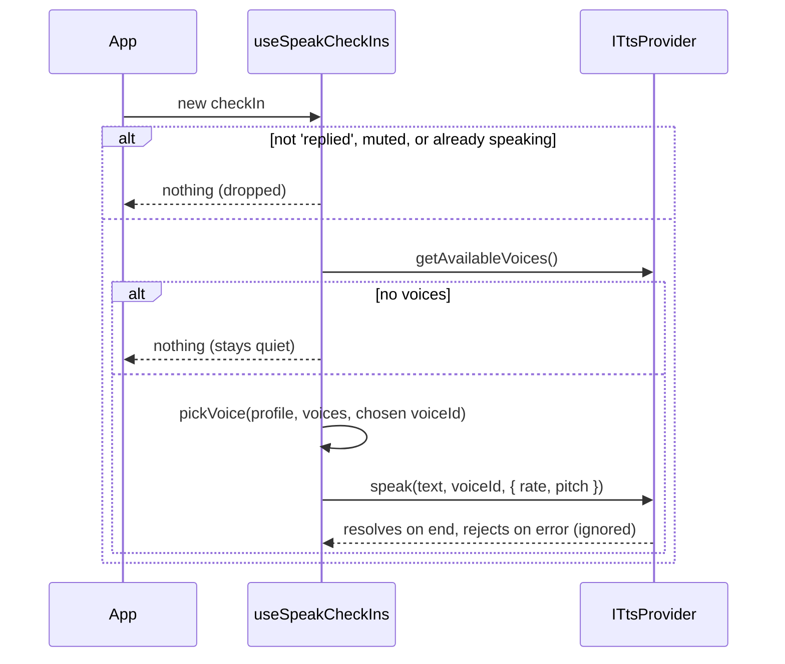
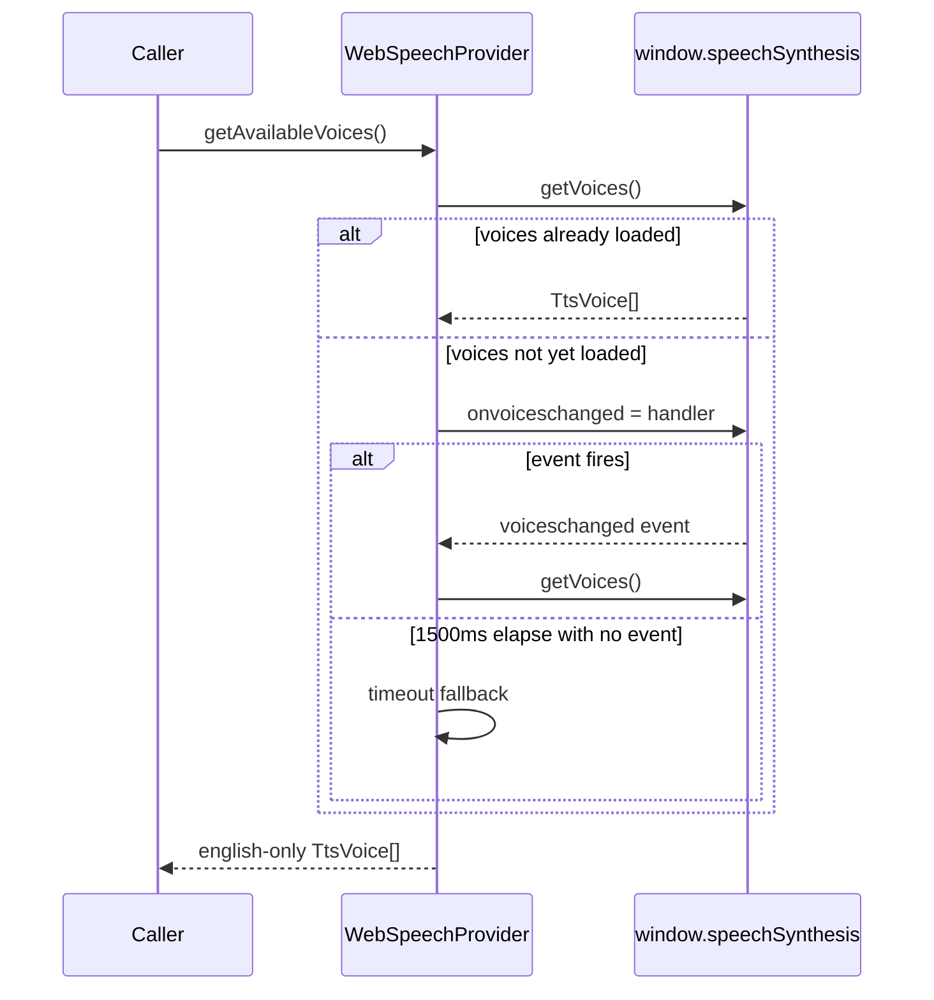

# Text-to-Speech (TTS) Subsystem

Speaks coach check-ins aloud, offline, in a voice that fits the chosen persona. A provider abstraction with two engines — the OS's own voices and Kokoro, a neural model on the GPU — a persona → voice table, and the hook that ties them to check-ins.

---

## 1. Directory Manifest & Boundaries

*   **Directory Manifest:**
    *   `types.ts`: `ITtsProvider` interface and `TtsVoice` shared shape, so the UI can treat any provider's voices uniformly.
    *   `WebSpeechProvider.ts`: `ITtsProvider` implementation backed by the browser's native `SpeechSynthesis` API.
    *   `WebSpeechProvider.test.ts`: Voice enumeration (immediate, `onvoiceschanged`-deferred, and timeout-fallback paths), playback, errors, `stop()` and `onVoicesChanged()`.
    *   `KokoroProvider.ts`: `ITtsProvider` over Kokoro-82M. Loads the model lazily (once, retried after a failure), generates audio, plays it through an injected `PlayAudio`. Exports `KOKORO_VOICES`, the curated voice list.
    *   `KokoroProvider.test.ts`: Voices without a download, generate-then-play, default voice, load once, retry after a failed load, `stop()` during playback and during generation.
    *   `loadKokoro.ts`: The real model loader, imported dynamically so kokoro-js and transformers.js are a separate chunk that only loads when Kokoro is used. Points the ONNX runtime at bundled WASM files.
    *   `playAudio.ts`: `playThroughSpeakers()`, mono samples through an `AudioContext`. Not unit tested (jsdom has no `AudioContext`); verified in the app.
    *   `voiceProfiles.ts`: Pure. `VOICE_PROFILES` (rate, pitch, voice-name hints and a sample line per persona) and `pickVoice()`.
    *   `voiceProfiles.test.ts`: Every persona covered, values in Web Speech range, the Drill Sergeant faster and lower than the Mentor, no two personas alike on stock Windows voices or on Kokoro, and `pickVoice` precedence.
    *   `useSpeakCheckIns.ts`: React hook that speaks replied check-ins through an `ITtsProvider`.
    *   `useSpeakCheckIns.test.ts`: Hook tests against a fake provider — warm-up only while unmuted, what is spoken and in which voice, mute, no overlap, no repeats on a settings change, no voices, errors, preview.
*   **Integration Boundaries:**
    *   **Web Speech API:** Interfaces directly with `window.speechSynthesis` / `SpeechSynthesisUtterance`, native to Chromium/Electron's renderer. On Windows these are the system's SAPI voices — no network calls, no external service.
    *   **kokoro-js** (Apache-2.0) → `@huggingface/transformers` → `onnxruntime-web` on WebGPU. The model (`onnx-community/Kokoro-82M-v1.0-ONNX`, fp32, ~300 MB) and each voice file download once from Hugging Face and are cached by the browser, as web-llm's models are; text never leaves the machine. The ONNX runtime's own `.mjs`/`.wasm` are bundled through the `ort-runtime` alias in `vite.config.ts` instead of the CDN transformers.js defaults to (which the CSP would block). The installer excludes these packages' `node_modules`; Vite has already bundled them.
    *   **Check-ins:** consumes `CheckIn` from `services/focus/useFocusCheckIn.ts`. Only `outcome: 'replied'` is spoken.
    *   **Settings:** `SpeechSettings` (`enabled`, `voiceId`) lives in `src/shared/types.ts` and is saved with the rest of the state (ADR-009); `App.tsx` adds the current persona and passes all three in.

> **Wired in.** `App.tsx` holds one provider per engine (`system` → `WebSpeechProvider`, `kokoro` → `KokoroProvider`) and runs `useSpeakCheckIns(checkIn, TTS_ENGINES[state.speech.engine], { ...state.speech, preset })`. The Coach tab has a "Speak check-ins" switch, an engine picker, a voice picker ("Automatic" = per persona) and a "Try voice" button. Switching engine resets the voice to Automatic. System voices are the default, so nobody gets a 300 MB download they did not choose.
>
> **Why Kokoro runs on WebGPU only.** Measured in the app: WASM generated 4.9s of audio in 8.9s (single-threaded, because the page is not cross-origin isolated); WebGPU generated 4.85s in 0.7s once warm (~2.5s the first time). The LLM already requires WebGPU.
>
> **No voices.** On Linux/WSL, Electron often reports no voices at all. The hook then speaks nothing and the Coach tab says check-ins are shown but not spoken. Nothing throws.
>
> Licensing/feature-gating on TTS providers was removed with the rest of the licensing subsystem — see `docs/adr/008-retire-camera-pipeline-and-licensing.md`.

---

## 2. Architecture & Flow



### Speaking one check-in


### Voice Enumeration (handles both sync and async voice list loading)


---

## 3. Public Interfaces & Contracts

### Data Structures

#### `TtsVoice`
```typescript
interface TtsVoice {
  id: string;   // the native voice name, e.g. "Microsoft David - English (United States)"
  name: string;
  provider: 'webspeech' | 'kokoro' | 'cloud' | 'piper';
}
```

#### `SpeechSettings` (`src/shared/types.ts`, persisted)
```typescript
type TtsEngine = 'system' | 'kokoro';
interface SpeechSettings {
  enabled: boolean;
  engine: TtsEngine;
  voiceId: string | null; // a voice of that engine; null = per persona
}
```

#### `ITtsProvider`
```typescript
interface ITtsProvider {
  initialize(config?: any): Promise<void>;
  getAvailableVoices(): Promise<TtsVoice[]>;
  speak(text: string, voiceId: string, options?: { pitch?: number; rate?: number }): Promise<void>;
  stop(): void;
  onVoicesChanged(listener: () => void): () => void; // returns unsubscribe
}
```

#### `VoiceProfile`
```typescript
interface VoiceProfile {
  rate: number;         // Web Speech rate, 1 = normal
  pitch: number;        // Web Speech pitch, 1 = normal
  voiceHints: string[]; // voice-name fragments, best first, case-insensitive
  sample: string;       // one line in character, for "Try voice"
}
```

| Persona | Rate | Pitch | Kokoro voice | Windows voice |
| :--- | :--- | :--- | :--- | :--- |
| Drill Sergeant | 1.2 | 0.6 | `am_fenrir` (US male, deep) | David |
| Sarcastic Critic | 1.05 | 1.1 | `bm_fable` (UK male) | Mark |
| Supportive Mentor | 0.9 | 1.05 | `af_heart` (US female) | Zira |
| Disappointed Parent | 0.85 | 0.9 | `bf_emma` (UK female) | Hazel, else Zira |

Kokoro uses the rate as its `speed` and ignores pitch.

---

### `pickVoice(profile, voices, chosenVoiceId)`
*   **Output:** `string` — a voice id.
*   **Description:** The chosen voice if it is still installed; else the first voice whose id or name contains a hint, in hint order; else `''`, which the provider reads as its default voice.

### `useSpeakCheckIns(checkIn, tts, settings)`
*   **Input:** `checkIn: CheckIn | null`, `tts: ITtsProvider`, `settings: { enabled: boolean; voiceId: string | null; preset: LlmPreset }`
*   **Output:** `{ voices: TtsVoice[]; preview: () => void }`
*   **Description:** Calls `tts.initialize()` whenever speech is on (for Kokoro, this starts the model download early) and `tts.stop()` when muted or when the provider changes. Speaks each new `'replied'` check-in once. Settings are read at speak time, so changing them never repeats the last check-in. Never overlaps: a check-in that arrives mid-sentence is dropped. Turning `enabled` off calls `tts.stop()`. Voices are fetched on mount, again whenever `onVoicesChanged` fires, and again at each speak: on a cold start Windows can take longer than `getAvailableVoices()`'s 1.5s timeout to report them. `preview()` speaks the persona's sample line even while muted.

---

### `KokoroProvider` Class (implements `ITtsProvider`)

`new KokoroProvider(loadModel = loadKokoro, play = playThroughSpeakers)`

*   **`initialize()`:** loads the model (downloading it the first time). A failed load is forgotten, so the next call retries.
*   **`getAvailableVoices()`:** `KOKORO_VOICES`, 11 English voices; never downloads anything.
*   **`speak(text, voiceId, { rate })`:** `generate(text, { voice: voiceId || 'af_heart', speed: rate ?? 1 })`, then plays the samples; resolves when playback ends or is stopped.
*   **`stop()`:** stops playback, and makes any sentence still being generated skip playing.
*   **`onVoicesChanged()`:** a no-op; the list is fixed.

---

### `WebSpeechProvider` Class (implements `ITtsProvider`)

#### `initialize()`
*   **Output:** `Promise<void>`
*   **Description:** Marks the provider initialized. Logs a console warning (does not throw) if `window.speechSynthesis` is unavailable in the current environment.

#### `getAvailableVoices()`
*   **Output:** `Promise<TtsVoice[]>`
*   **Description:** Returns English-only (`lang` starting with `en`) native voices, mapped to `TtsVoice` with `provider: 'webspeech'`. Returns `[]` immediately if Speech Synthesis isn't supported. Handles browsers that populate the voice list asynchronously by waiting on `onvoiceschanged`, with a 1500ms fallback timeout.

#### `speak(text, voiceId, options?)`
*   **Input:** `text: string`, `voiceId: string` (matched against native voice `name`), `options?: { pitch?: number; rate?: number }`
*   **Output:** `Promise<void>` — resolves on `utterance.onend`, rejects on `utterance.onerror`.
*   **Description:** Cancels any in-progress speech (`synth.cancel()`) before speaking. Throws if Speech Synthesis isn't supported.

#### `stop()`
*   **Description:** `synth.cancel()`. Does nothing if Speech Synthesis isn't supported.

#### `onVoicesChanged(listener)`
*   **Output:** `() => void` — unsubscribe.
*   **Description:** Adds a `voiceschanged` event listener. Uses `addEventListener`, not the `onvoiceschanged` property, because `getAvailableVoices()` sets and clears that property itself. A no-op when Speech Synthesis isn't supported.
